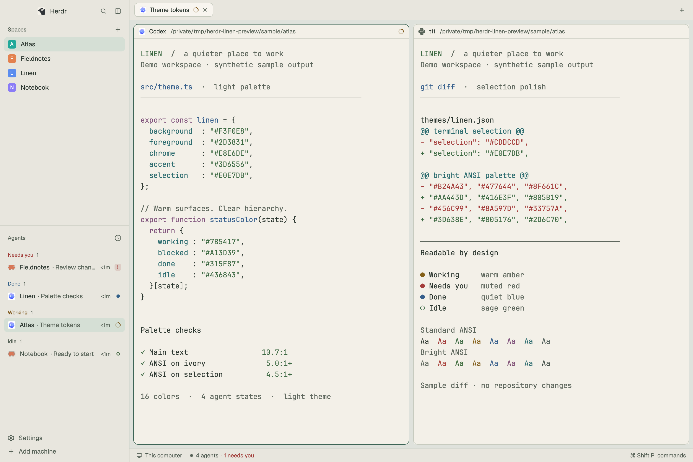

# Linen for Herdr

A warm, readable light theme for long coding sessions. Ivory terminals, stone chrome, sage accents, and charcoal text, with a familiar workspace layout.



Linen includes a standalone terminal/UI theme and an optional workspace layout based on Herdr's standard layout. The screenshot is a real Herdr window with synthetic demo projects and terminal output.

## Install with your agent

```text
Read ~/.config/herdr-app/AGENTS.md, then read https://github.com/ritiksahni/herdr-linen and its RECIPE.md. Install the Linen theme and layout alongside my existing layouts, preserving any files with conflicting names.
```

## Install manually

Run these from this repository. These commands use Herdr's default configuration folder; substitute your `HERDR_APP_HOME` if you use one. Existing files with the same names are preserved. If a name is already taken, compare the files or rename the new theme/layout and update their references before continuing.

### Theme only

```sh
mkdir -p ~/.config/herdr-app/themes
cp -n themes/linen.json ~/.config/herdr-app/themes/linen.json
herdr-app do app.theme --name linen
```

The theme picker applies Linen to the current layout's light appearance. Choose **Light** in Settings → Look to see it if your app currently uses a dark appearance.

### Theme and workspace layout

Install the theme above, then:

```sh
mkdir -p ~/.config/herdr-app/layouts
cp -n layouts/linen-workspace.json ~/.config/herdr-app/layouts/linen-workspace.json
cp -n layouts/linen-workspace.svg ~/.config/herdr-app/layouts/linen-workspace.svg
herdr-app do layout.switch --name linen-workspace
herdr-app do app.theme --name linen
```

The layout uses Herdr's built-in panels. See [mods/README.md](mods/README.md) for the dependency list. Your spaces, tabs, and terminals remain the same across layouts. Switch back with `herdr-app do layout.switch --name main`.

## Design

Warm ivory softens the terminal surfaces, stone separates the surrounding controls, and sage marks focus. Charcoal text and carefully tuned terminal colors keep code, diffs, and agent statuses clear.

The palette takes inspiration from linen's natural warmth and lightness.

| Role | Color |
| --- | --- |
| Terminal | `#F3F0E8` |
| Main text | `#2D3831` |
| Sidebar and bars | `#E8E6DE` |
| Canvas | `#DFE2DC` |
| Accent | `#3D6556` |
| Terminal selection | `#E0E7DB` |

The 16 ANSI colors have at least **5.0:1** contrast against the terminal background and **4.5:1** against the selection fill. Main text is **10.7:1**. These are calculated palette ratios, not a guarantee for every terminal application: programs can choose their own truecolor values, dim text, or backgrounds.

The workspace keeps Spaces and Agents on the left, tabs above the terminals, optional Files/Changes on the right, and status along the bottom. It adds no keyboard overrides or custom JavaScript.

## Compatibility

Validated with Herdr desktop **0.1.10** on macOS. Other platforms have not been visually tested. The theme is a light palette; existing theme-picker choices can override a layout's theme.

See [RECIPE.md](RECIPE.md) for the complete design brief, behavior, palette, and rebuild instructions. The preview demonstrates sample content; installing Linen does not create projects or agents.

## License

Apache-2.0. The workspace layout is adapted from Herdr's shipped `main` layout. See [NOTICE](NOTICE) and [LICENSE](LICENSE).
