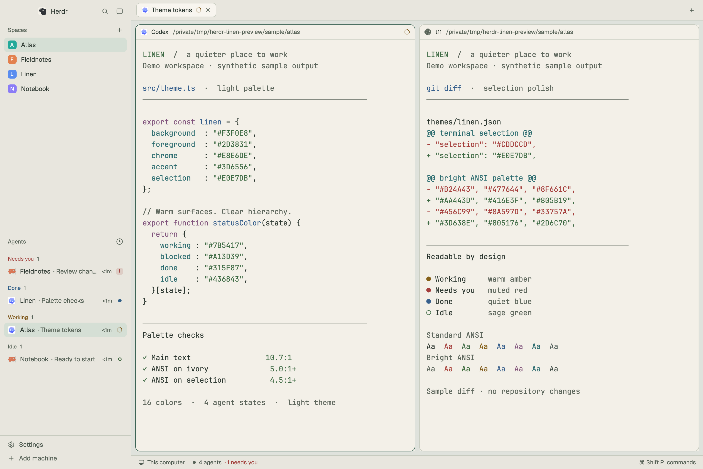

# Linen

A quiet light workspace for coding agents: warm ivory terminals sit inside stone-colored chrome, with charcoal text, sage focus and selection accents, and restrained status colors. Spaces and agents stay visible on the left; the active work fills the center. The palette takes inspiration from linen's natural warmth and lightness. This is a brief another agent can build from an empty folder in a current Herdr installation. The adjacent files are one implementation, based on Herdr desktop 0.1.10.



## What you see

The window has no separate system title bar. At zoom 1, arrange it as a horizontal row with a 1px border-colored divider:

1. A 268px-wide left sidebar, resizable from 44 to 480px, with a stone background. Its top 46px contains Herdr's brand, search, and sidebar control. Below it, Spaces and Agents share the remaining list area equally, each at least 90px tall. The bottom 69px contains settings and machine controls. The list container has no additional divider.
2. A flexible work column. A 42px tab strip sits at the top. The body has 8px padding and 8px gaps. Terminals occupy the available area; an optional panel on the right starts hidden, is 368px wide when open, and resizes from 280 to 900px. A 28px status bar sits at the bottom.
3. Every terminal pane, including a lone one, has a 10px corner radius, a 1px neutral border, an 8px gap to adjacent panes, and a 30px always-visible header. The focused pane's border is sage. Terminal padding is 14px vertically and 12px horizontally.

Use the person's font settings. With Herdr's defaults, terminal text is JetBrains Mono at 14px and UI text uses Geist. The screenshot uses 15px terminal text. Do not introduce bundled fonts or a fixed zoom. On macOS, leave space for the native window buttons at `[12, 16]`.

The palette is deliberately warm without a yellow wash:

| Color role | Value |
| --- | --- |
| Terminal background | `#F3F0E8` |
| Foreground | `#2D3831` |
| Canvas behind panes | `#DFE2DC` |
| Sidebar and bars (`chrome`) | `#E8E6DE` |
| Surface | `#ECEAE2` |
| Popover | `#F5F2EB` |
| Raised surface | `#F8F5EF` |
| Hover | `#E2E5DC` |
| Selected UI row | `#D5DFD5` |
| Border | `#C7CBBF` |
| Input | `#DFE4DC` |
| Muted text | `#4F5B51` |
| Dim text / unknown status | `#596459` |
| Accent, solid button, cursor | `#3D6556` |
| Text on accent / solid button | `#F7F5EE` |
| Terminal selection | `#E0E7DB` |
| Working | `#7B5417` |
| Blocked | `#A13D39` |
| Done | `#315F87` |
| Idle | `#436843` |

ANSI colors, in index order 0–15:

```text
0  #2F3831    1  #A43D3B    2  #3F6B45    3  #856018
4  #365F8C    5  #80537C    6  #2E6D70    7  #52605B
8  #5F685E    9  #AA443D   10  #416E3F   11  #805B19
12 #3D638E   13  #805176   14  #2D6C70   15  #434F48
```

Keep ANSI white and bright-white dark enough to read on this light background. Retain the color families so diffs, links, errors, and warnings remain recognizable.

## How it behaves

Use the standard Herdr workspace behavior. Spaces select their work; tabs select a task; agents focus their terminal. The sidebar tracks live data, including agents in other spaces and reported child agents. Agent order and grouping belong to the built-in Agents panel and retain the person's choices.

| Agent status | Appearance |
| --- | --- |
| Working | Amber status text and the native spinning indicator |
| Blocked | Muted red, a “Needs you” badge; compact rows use an exclamation mark |
| Done | Blue status dot; completion becomes idle when seen, with Herdr's normal list-stability behavior |
| Idle | Green outlined status ring |

Statuses come from the terminal program's reports, not inferred screen text. A program without a report does not become a fake agent. Hovered rows get the hover fill; selected rows get the sage-tinted selected fill. Focused terminal borders stay distinct from neutral pane borders.

The sidebar can be resized and folded using its normal controls. Below 160px, the built-in panels render their compact forms. Tabs retain the standard add menu. Files and Changes open from the tab bar and remain remembered per space. Pane headers retain split, zoom, and close controls. Split panes retain Herdr's drag and resize behavior. Native popups, menus, and dialogs use the same semantic colors.

Install no key overrides. Existing shortcuts continue to work; with the current standard macOS bindings, Command-B toggles the sidebar and Command-Shift-L cycles layouts. Bindings differ by platform and user configuration, so the command palette remains authoritative.

Linen does not create terminals, run agents, or rearrange a person's existing tabs. Switching layouts changes the view of the same work.

## Built from

Create `themes/linen.json` with `background`, `foreground`, `selection`, `cursor`, a 16-entry `ansi` array, and a `colors` object containing the semantic palette above. Theme colors use six-digit hex values. Include both top-level terminal colors and their matching semantic color entries.

Create `layouts/linen-workspace.json` by cloning Herdr's standard `main` layout, then set its root `theme` to `"linen"` and `preview` to `"layouts/linen-workspace.svg"`. Keep its `cloned_from` provenance if cloning. Preserve these node IDs because built-in controls target them:

```text
root (row)
├── sidebar (column)
│   ├── brand → workspace-chrome
│   ├── sidebar-lists (column)
│   │   ├── spaces → spaces
│   │   └── agents → agents
│   └── sidebar-footer → workspace-chrome, props: {footer: true}
└── work (column)
    ├── tabs → tabs
    ├── work-body (row)
    │   ├── main → content: {tab: "active", pane: {...}}
    │   │          pane.header.content.mod: "pane"
    │   └── panel (column, initially hidden)
    │       └── panel-body (stack, active: "files")
    │           ├── files → files
    │           └── changes → changes
    └── status → workspace-status
```

The `brand` and `tabs` blocks allow window dragging. Keep the sidebar and work column's internal resize behavior from the standard layout. The root divider makes the sidebar width resizable. Pane content has `lone: true`; headers have `position: "top"` and `reveal: "always"`.

These eight mods ship with Herdr: `workspace-chrome`, `spaces`, `agents`, `tabs`, `pane`, `files`, `changes`, and `workspace-status`. They in turn use Herdr's shipped menus, pickers, icons, and dialogs. There is no custom JavaScript to copy: `mods/README.md` records these dependencies. Reuse the installed versions rather than overwrite shipped mod folders. Their data comes from Herdr's live spaces, agents, panes, and terminals; their controls dispatch the standard `space.*`, `tab.*`, `pane.*`, `agent.*`, `layout.*`, and app commands.

The theme and layout themselves run no programs and fetch no URLs. Built-in Files/Changes and workspace panels retain Herdr's normal filesystem, git, and machine behavior. Do not describe the whole host application as network-free.

Create a small SVG layout thumbnail with the palette and pane arrangement, saved as `layouts/linen-workspace.svg`. The full-size `preview.png` must be a screenshot of the real app. Use synthetic demo projects, ANSI-colored code, a diff, and reported demo statuses to demonstrate the colors without including personal terminal content. Clearly identify the scene as demo content in the README. Demo scripts and processes are not part of the installed layout.

## Watch out

- This targets the desktop app, controlled by `herdr-app`, not the older Herdr TUI. Read the installed desktop `AGENTS.md` and type definitions when adapting it.
- Shipped layouts and mods are replaced on app startup. Keep the new layout in its own file and avoid editing shipped modules.
- Preserve the person's settings, keybindings, saved layout state, and active terminals. Do not distribute `view.json`, `shared.json`, `layouts/.state/`, machine configuration, or session IDs.
- Use different names for the layout (`linen-workspace`) and theme (`linen`), so the theme can also be selected independently of this layout. Copy both the theme and layout for a full installation.
- Existing theme-picker overrides can win over the root theme. Apply `app.theme {name: "linen"}` after selecting the layout if necessary. The standalone theme is intended for light appearance; a person's appearance choice is separate from theme installation.
- Theme-only installation must not overwrite an unrelated existing `linen.json`. If the name is taken, rename the new theme and update the layout's theme reference. Do the same for layout-name conflicts and its preview path.
- Contrast figures describe this palette only. All 16 ANSI colors are at least 5.0:1 against the terminal background and 4.5:1 against the terminal selection fill; foreground is 10.7:1. Truecolor output, dim ANSI attributes, reverse video, and application-selected backgrounds can produce other contrasts. Do not force Herdr's global minimum-contrast setting.
- At narrow sizes, use the native sidebar fold or pane zoom. Do not add horizontal scrolling or claim that every panel fits every window width. The screenshot is a 1440×961 logical-pixel demo window, captured at 2880×1922 pixels.
- This package uses the standard workspace panels in Herdr 0.1.10. If newer built-in panels expect different node IDs or layout structure, rebuild from their current standard layout and this brief.

## Done when

- Installing into a clean Herdr home shows the Linen theme and Linen workspace as additional choices; an existing layout can still be selected.
- `herdr-app status` reports `layout: "linen-workspace"` with no file or mod errors after switching to it.
- Spaces, tabs, agents, and live terminals render; selecting a space, tab, or agent brings the appropriate terminal into view.
- All four reported agent states have the intended colors and indicators. A non-reporting shell remains a terminal rather than a fabricated agent.
- The sidebar can be hidden and shown, and the work area expands and contracts. Files and Changes can be opened through their existing controls. A split terminal can be focused and zoomed.
- Inspect the code, diff colors, subdued text, selected terminal text, and UI selections in the real app. Verify the stated palette contrast ratios independently.
- The eight referenced built-in mods pass `herdr-app check <installed-mod-folder>`. This eager-render check is supplemented by running the layout; it does not test every delayed interaction.
- `preview.png` shows the actual layout using synthetic content. The package contains no user session data or private terminal output.
